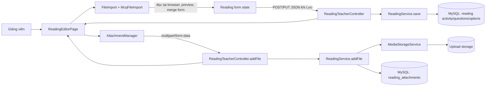
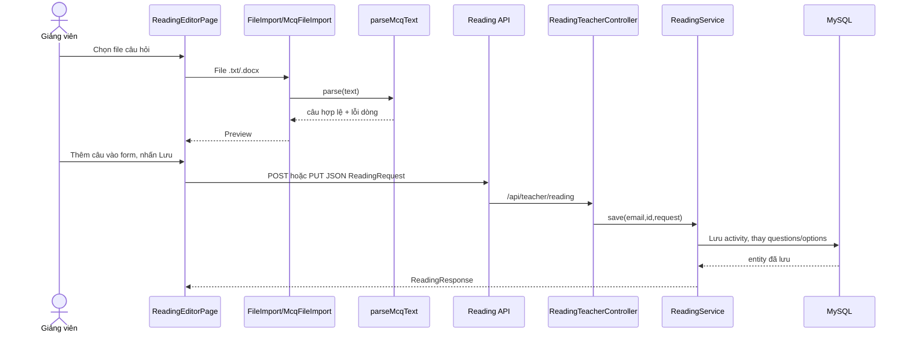
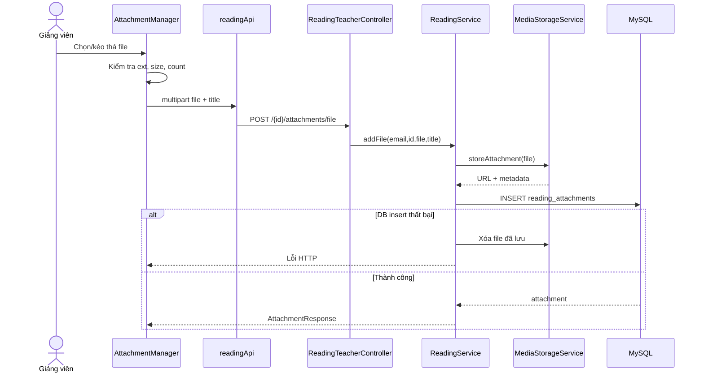
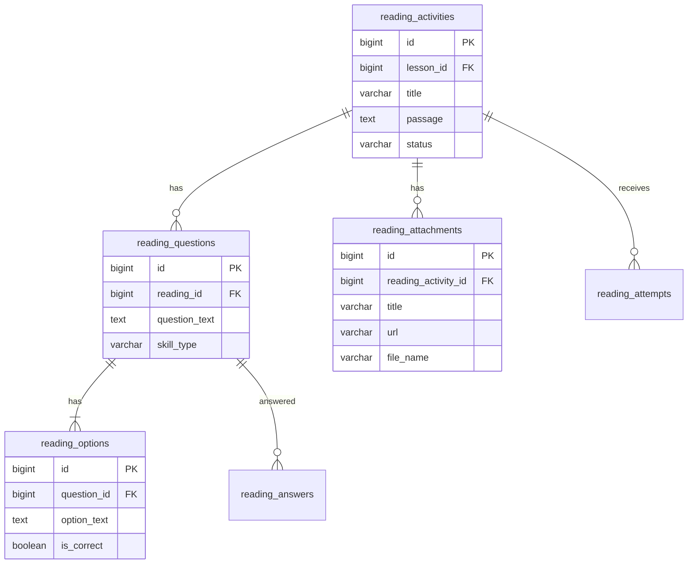
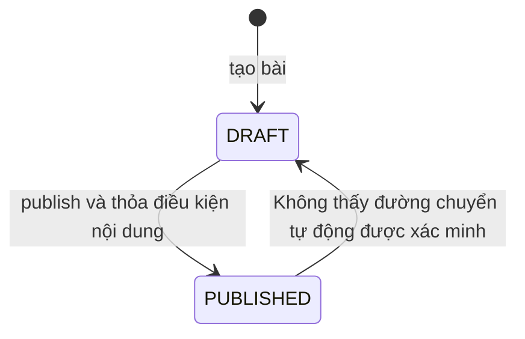

# Tài liệu kỹ thuật: nhập file cho phần Reading

> Phạm vi gồm hai thao tác trong màn hình biên tập Reading: (1) nhập câu hỏi trắc nghiệm từ `.txt`/`.docx` vào form; (2) tải tài liệu đính kèm của bài Reading lên backend. Hai thao tác dùng định dạng, giới hạn và API khác nhau.

## 1. Tổng quan

Giảng viên dùng tính năng này để đưa nhanh câu hỏi Reading vào form và/hoặc gắn tài liệu tham khảo cho bài học. Trình duyệt đọc file câu hỏi và kiểm tra cấu trúc trước khi đưa các câu hợp lệ vào form; dữ liệu câu hỏi chỉ được gửi lên server khi nhấn **Lưu**. Tệp đính kèm được upload riêng theo từng file tới backend; backend lưu file và metadata gắn với Reading. Luồng nằm trên `ReadingEditorPage` và được bảo vệ bởi quyền TEACHER ở API (`README.md:31-45`, `Frontend/src/pages/teacher/ReadingEditorPage.jsx:156-243`, `backend/src/main/java/elearning/controller/ReadingTeacherController.java:22-25`).

**TL;DR:** Với nhập câu hỏi, chọn `.txt` hoặc `.docx` tối đa 1 MB → xem trước/các lỗi theo dòng → thêm câu hợp lệ vào form → nhấn Lưu để POST/PUT JSON. Với tệp đính kèm, chọn hoặc kéo thả PDF/Word/ảnh → client kiểm tra loại, dung lượng 20 MB và số lượng tối đa 10 → multipart upload đến endpoint attachment → backend lưu file rồi metadata. Không thấy queue/worker trong hai luồng này.

## 2. Thuật ngữ

| Thuật ngữ | Ý nghĩa | Nơi xuất hiện trong code |
|---|---|---|
| MCQ | Câu hỏi trắc nghiệm nhiều lựa chọn | `McqFileImport`, `parseMcqText` |
| Preview | Bản xem trước trước khi thay đổi form | `FileImport.jsx` |
| Draft attachment | Metadata tệp tạm ở form tạo mới, chưa gắn ID Reading | `ReadingEditorPage.jsx`, `AttachmentManager.jsx` |
| Multipart/form-data | Kiểu HTTP body truyền file cùng trường văn bản | `ReadingTeacherController.addFile` |
| Transaction | Nhóm thao tác DB commit/rollback cùng nhau | `ReadingService.save`, `ReadingService.addFile` |
| Evidence | Căn cứ trong bài đọc hỗ trợ đáp án | `ReadingDto`, `ReadingService` |

## 3. User flow

1. Giảng viên vào trang tạo/sửa Reading. `ReadingEditorPage` tải dữ liệu hiện có khi sửa, khởi tạo form và trạng thái file đính kèm (`Frontend/src/pages/teacher/ReadingEditorPage.jsx:156-195`).
2. **Nhập câu hỏi:** bấm “Tải file mẫu” hoặc chọn `.txt`/`.docx`; trình duyệt đọc nội dung, parser tạo câu hợp lệ và danh sách lỗi dòng. `.doc` không được hỗ trợ, file trên 1 MB bị từ chối (`Frontend/src/components/material-view/FileImport.jsx:20-60`).
3. Xem trước và nhấn nút thêm câu. Câu hợp lệ được merge vào câu đang có; câu lỗi bị loại. Thao tác này chưa gọi API (`Frontend/src/components/material-view/McqFileImport.jsx:15-34`).
4. **Tệp đính kèm:** chọn nhiều file hoặc kéo thả. Client xác thực từng file; khi bài đã tồn tại, file upload ngay. Khi tạo bài mới, file được giữ tạm trong state cho tới khi bài được lưu để có `readingId` (`Frontend/src/components/grammar/AttachmentManager.jsx:70-133`, `Frontend/src/pages/teacher/ReadingEditorPage.jsx:225-231`).
5. Nhấn **Lưu**. Client yêu cầu phân công course-week/lesson, tiêu đề và nội dung bài đọc hoặc ít nhất một file; sau đó gọi POST khi tạo hoặc PUT khi sửa. Nếu tạo mới kèm draft file, các file được upload sau khi nhận ID (`ReadingEditorPage.jsx:198-243`).

Trạng thái UI gồm đang đọc/đang nhập, preview có số câu hợp lệ và lỗi theo dòng, tiến trình upload %, thông báo lỗi và danh sách đính kèm. Empty state của file hiện tại thể hiện bằng danh sách rỗng; trong preview, nút xác nhận bị khóa khi không có câu hợp lệ (`FileImport.jsx:84-170`, `AttachmentManager.jsx:174-309`).

## 4. Kiến trúc tổng thể



Không thấy API gateway riêng, hàng đợi hoặc worker tham gia các luồng này. Frontend gọi API backend trực tiếp qua `axiosClient`; cấu hình base URL nằm trong `Frontend/src/services/axiosClient.js`.

## 5. Frontend

Trang chính là `ReadingEditorPage`. State của biểu mẫu do hook form và state React giữ; câu hỏi nhập file được merge vào `form.questions`. File đính kèm được tách thành danh sách đang tồn tại và danh sách draft (`files ?? attachments`). Nhập câu hỏi có parser xác định, không dùng AI; `.docx` được giải nén văn bản trong browser bằng Mammoth. Attachment manager dùng `attachments.js` để kiểm tra định dạng, kích thước và số lượng trước upload (`questionImport.js:18-159`, `FileImport.jsx:20-60`, `attachments.js:4-5,101-108`).

**`ReadingEditorPage.save` — `Frontend/src/pages/teacher/ReadingEditorPage.jsx:198-243`**
```jsx
  async function save(e) {
    e.preventDefault();
    if (!form.courseWeekId || !form.lessonId) {
      setState({ saving: false, error: "Vui lòng chọn đầy đủ khóa học, tuần và bài học" });
      return;
    }
    if (body && !form.passage.trim() && !currentFiles.length) {
      setState({ saving: false, error: EMPTY });
      return;
    }
    setState({ saving: true, error: "" });
    try {
      const payload = {
        courseWeekId: Number(form.courseWeekId), lessonId: Number(form.lessonId),
        title: form.title, description: form.description, instruction: form.instruction,
        passage: form.passage, passageFormat: form.passageFormat,
        toeicPart: form.toeicPart, passageType: form.passageType, questions: form.questions,
      };
      const saved = editing
        ? await readingApi.teacherUpdate(id, payload)
        : await readingApi.teacherCreate(payload);
      let failed = [];
      if (!editing && currentFiles.length) failed = await uploadDrafts(saved.id, currentFiles, readingApi);
    } catch (err) { setState({ saving: false, error: err.response?.data?.message || "Không thể lưu bài đọc" }); }
  }
```
Handler kiểm tra course-week/lesson và nội dung tùy mode, gửi payload JSON bằng API tạo/sửa; khi tạo mới, file draft được upload sau khi backend trả ID. `body` là cờ boolean theo mode editor, không phải nội dung đoạn văn (`ReadingEditorPage.jsx:164`), vì vậy điều kiện kiểm tra passage/file không phải điều kiện luôn sai.

**`McqFileImport` — `Frontend/src/components/material-view/McqFileImport.jsx:15-34`**
```jsx
      parse={(text) => {
        const { questions: items, errors } = parseMcqText(text);
        return {
          errors,
          items: items.map(({ line, ...q }) =>
            kind === "reading" ? q : { ...q, explanation: "", evidence: "" },
          ),
        };
      }}
      renderItem={(q) => <McqPreview q={q} />}
      onImport={(items) => onChange(mergeImported(questions, items, isBlankQuestion))}
```
Parser loại số dòng nội bộ khỏi object câu hỏi đưa vào form. Với Reading, explanation/evidence được giữ nguyên; danh sách câu mới được merge với state hiện có.

**API client upload — `Frontend/src/services/learningContentService.js:99-119`**
```js
  teacherCreate: async (data) => (await axiosClient.post("/teacher/reading", data)).data,
  teacherUpdate: async (id, data) => (await axiosClient.put(`/teacher/reading/${id}`, data)).data,
  uploadAttachment: async (id, file, title, onProgress) => {
    const form = new FormData();
    form.append("file", file);
    if (title) form.append("title", title);
    return (
      await axiosClient.post(`/teacher/reading/${id}/attachments/file`, form, {
        timeout: 300000,
        onUploadProgress: (e) => e.total && onProgress?.(Math.round((e.loaded / e.total) * 100)),
      })
    ).data;
  },
```
Import câu hỏi không có API riêng; API chỉ chạy lúc lưu form. Upload attachment gửi `FormData` riêng và cập nhật phần trăm tiến độ nếu browser cung cấp tổng dung lượng.

Không thấy feature flag riêng; quyền được kiểm tra thực tế ở backend. UI ẩn/khóa một số thao tác khi `disabled`/`inUse`; không xem đây là ranh giới bảo mật.

## 6. API contract

Base prefix là `/api` theo README. Controller có `@PreAuthorize("hasRole('TEACHER')")`.

| Method | Path | Request | Response / status | Ghi chú |
|---|---|---|---|---|
| POST | `/api/teacher/reading` | JSON `ReadingRequest` | `ReadingResponse`, 201 Created | Tạo bài |
| PUT | `/api/teacher/reading/{id}` | JSON `ReadingRequest` | `ReadingResponse`, 200 | Sửa bài |
| POST | `/api/teacher/reading/{id}/attachments/file` | multipart: `file` bắt buộc, `title` tùy chọn | `AttachmentResponse`, 201 Created | Upload file đính kèm |

Lỗi phổ biến: 400 cho `IllegalArgumentException`/validation, 401 authentication exception, 403 quyền/ownership, 409 integrity conflict, 413 upload vượt giới hạn cấu hình. Cấu trúc lỗi chung có `timestamp`, `status`, `error`, `message`, `path`, tùy trường hợp thêm `fieldErrors` (`GlobalExceptionHandler.java:23-100`). API response creation/update là DTO Reading với `id`, `status`, `questions`, `attachments`, `inUse`, `attemptCount` (`ReadingDto.java:46-73`).

Ví dụ request tạo bài (tối giản theo DTO):

```json
{
  "courseWeekId": 12,
  "lessonId": 45,
  "title": "Reading: Office Notice",
  "passage": "Notice text...",
  "questions": [{
    "questionText": "When does the event start?",
    "explanation": "The notice states the start time.",
    "evidence": "The event begins at 9 a.m.",
    "skillType": "DETAIL",
    "options": [
      {"optionText": "8 a.m.", "correct": false},
      {"optionText": "9 a.m.", "correct": true}
    ]
  }]
}
```

**Endpoint upload — `ReadingTeacherController.addFile`, `backend/src/main/java/elearning/controller/ReadingTeacherController.java:65-74`**
```java
    @PostMapping(path = "/{id}/attachments/file", consumes = MediaType.MULTIPART_FORM_DATA_VALUE)
    public AttachmentResponse addFile(
            Principal p,
            @PathVariable Long id,
            @RequestParam("file") MultipartFile file,
            @RequestParam(required = false) String title) {
        return s.addFile(p.getName(), id, file, title);
    }
```
Endpoint nhận một file và tiêu đề tùy chọn; Principal xác định tài khoản chuyển xuống service để kiểm tra ownership. Không tìm thấy OpenAPI spec cho endpoint trong repository.

## 7. Backend

### Nhập câu hỏi

Backend không đọc file import MCQ. Parser chạy hoàn toàn ở frontend, chuyển các câu hợp lệ thành object form; khi người dùng lưu thì `ReadingTeacherController.create/update` nhận JSON có `@Valid`, gọi `ReadingService.save`. Service kiểm tra giáo viên, quan hệ course-week/lesson, nội dung, rồi thay thế câu hỏi và lựa chọn trong transaction. Mỗi question phải có ít nhất hai options và đúng một đáp án (`ReadingDto.java:18-43`, `ReadingService.java:97-153`).

### Tệp đính kèm

1. Controller xác thực vai trò TEACHER và chuyển file vào `ReadingService.addFile`.
2. Service tải activity và kiểm tra chủ sở hữu, khóa nếu activity đang được dùng, giới hạn 10 tệp.
3. `MediaStorageService.storeAttachment` kiểm tra/lưu nội dung file và trả metadata vị trí, loại MIME, kích thước.
4. Service tạo `ReadingAttachment` với tiêu đề, URL, tên file, MIME, kích thước, thứ tự rồi persist. Nếu lưu metadata thất bại, service xóa file đã ghi để tránh file mồ côi (`ReadingService.java:178-205`).

`ReadingService` có transaction ở cấp class; `save` xóa/tạo lại danh sách câu hỏi và options theo payload. Đây là thay thế toàn bộ tập câu hỏi gửi lên, không phải cập nhật từng câu theo ID. Không thấy queue, retry tự động hoặc idempotency key trong hai endpoint.

**`ReadingService.save` — `backend/src/main/java/elearning/service/ReadingService.java:101-153`**
```java
    public ReadingResponse save(String email, Long id, ReadingRequest r) {
        User t = teacher(email);
        ReadingActivity a = id == null ? new ReadingActivity() : owned(id, t.getId());
        requireNoAttempts(id);
        // ... gán bài học, nội dung và metadata Reading
        if (r.questions() == null || r.questions().isEmpty())
            throw new IllegalArgumentException("Bài Reading cần ít nhất một câu hỏi");
        a = activities.save(a);
        questions.deleteByActivityId(a.getId());
        for (ReadingRequest.Question qr : r.questions()) {
            ReadingQuestion q = new ReadingQuestion();
            q.setActivity(a);
            q.setQuestionText(qr.questionText());
            // ... map explanation/evidence/skill và persist options
        }
        return response(activities.save(a), true);
    }
```
Service dùng ownership từ tài khoản teacher và chặn sửa khi đã có lượt làm bài. Lưu câu hỏi thay tập câu hỏi hiện tại bằng dữ liệu mới trong transaction.

**Kiểm tra file và ghi metadata — `ReadingService.addFile`, `backend/src/main/java/elearning/service/ReadingService.java:178-205`**
```java
    public AttachmentResponse addFile(String email, Long id, MultipartFile file, String title)
            throws IOException {
        ReadingActivity a = owned(id, teacher(email).getId());
        activities.lockById(id);
        if (attachments.countByActivityId(id) >= MAX_ATTACHMENTS)
            throw new IllegalArgumentException(
                    "Mỗi bài Reading có tối đa " + MAX_ATTACHMENTS + " tệp đính kèm");
        MediaStorageService.StoredFile stored =
                media.storeAttachment(file, "reading/" + id, FILE_TYPES,
                        "Định dạng không được hỗ trợ. Chỉ nhận PDF, Word (DOC, DOCX) hoặc ảnh (PNG, JPG, WEBP)");
        ReadingAttachment item = new ReadingAttachment();
        item.setActivity(a);
        item.setTitle(title(title, stored.fileName()));
        item.setUrl(stored.url());
        item.setFileName(stored.fileName());
        item.setMimeType(stored.mimeType());
        item.setSizeBytes(stored.sizeBytes());
    }
```
Phần này cho thấy ownership, giới hạn 10 tệp, kiểm tra file qua storage service và ánh xạ metadata. Đoạn code tiếp theo tính thứ tự, lưu metadata và xóa file nếu DB flush lỗi (`ReadingService.java:198-205`).
**DTO validation — `backend/src/main/java/elearning/dto/ReadingDto.java:18-43`**
```java
    public record ReadingRequest(
            @NotNull Long courseWeekId,
            @NotNull Long lessonId,
            @NotBlank @Size(max = 200) String title,
            // ...
            List<@NotNull @Valid Question> questions) {
        public record Question(
                @NotBlank String questionText,
                // ...
                @NotNull @Size(min = 2) List<@NotNull @Valid Option> options) {
            @AssertTrue(message = "Mỗi câu hỏi phải có đúng một đáp án đúng")
            public boolean isExactlyOneCorrect() {
                return options != null && options.stream().allMatch(Objects::nonNull)
                        && options.stream().filter(Option::correct).count() == 1;
            }
        }
        public record Option(@NotBlank String optionText, boolean correct) {}
    }
```
Server kiểm tra dữ liệu JSON độc lập với parser frontend: trường bắt buộc, tối thiểu hai lựa chọn, đúng một lựa chọn đúng. Không thấy giới hạn tối đa số lựa chọn trong DTO này.

**Cleanup nếu DB lỗi — `ReadingService.addFile`, `backend/src/main/java/elearning/service/ReadingService.java:198-205`**
```java
        List<ReadingAttachment> current = attachments.findAllByActivityIdOrderBySortOrderAsc(id);
        item.setSortOrder(current.isEmpty() ? 1 : current.get(current.size() - 1).getSortOrder() + 1);
        try {
            return attachmentResponse(attachments.saveAndFlush(item));
        } catch (RuntimeException e) {
            media.delete(stored.url());
            throw e;
        }
    }
```
Nếu DB flush không thành công, service xóa file đã lưu rồi trả lỗi cho controller.

## 8. Sequence diagram

### Nhập câu hỏi và lưu Reading



### Upload tệp đính kèm



## 9. Data model

Các bảng chính được khai báo trong migration `backend/src/main/resources/db/manual/schema-upgrade-missing.sql:85-178`; entity tương ứng ở `ReadingActivity`, `ReadingQuestion`, `ReadingOption`, `ReadingAttachment`. Quan hệ khái quát:



Trạng thái bài chuyển dựa trên nội dung: `DRAFT` khi thiếu điều kiện nội dung bài đọc và `PUBLISHED` khi có passage hoặc attachment theo `ReadingService.hasContent`; thao tác publish riêng có endpoint. Chi tiết trạng thái bổ sung cần đối chiếu logic publish/service nếu thay đổi quy tắc.



**Mapping câu hỏi — `ReadingService.save`, `backend/src/main/java/elearning/service/ReadingService.java:130-153`**
```java
        questions.deleteByActivityId(a.getId());
        for (ReadingRequest.Question qr : r.questions()) {
            ReadingQuestion q = new ReadingQuestion();
            q.setActivity(a);
            q.setQuestionText(qr.questionText());
            q.setExplanation(qr.explanation());
            q.setEvidence(qr.evidence());
            q.setSkillType(qr.skillType() == null ? ReadingQuestion.SkillType.DETAIL : qr.skillType());
            q = questions.save(q);
            for (ReadingRequest.Option or : qr.options()) {
                ReadingOption o = new ReadingOption();
                o.setQuestion(q);
                o.setOptionText(or.optionText());
                o.setCorrect(or.correct());
                options.save(o);
            }
        }
```
Luồng xóa và tạo mới câu hỏi/options giúp đồng bộ snapshot JSON đã gửi. Vì vậy chỉ gửi các câu đang có trong form; đây không phải API patch từng câu.

## 10. Xử lý lỗi & edge case

| Tình huống | Hành vi backend | Hiển thị frontend | Khôi phục | Nguồn |
|---|---|---|---|---|
| File import sai đuôi / `.doc` | Không gọi backend | Báo chỉ hỗ trợ `.txt`/`.docx` | Lưu lại dạng `.docx` hoặc `.txt` | `FileImport.jsx:29-39` |
| File câu hỏi >1 MB | Không gọi backend | Báo giới hạn và gợi ý chia file | Chia file nhỏ | `questionImport.js:18`, `FileImport.jsx:35-39` |
| DOCX không đọc được/rỗng | Không gọi backend | Báo lỗi đọc file | Kiểm tra DOCX, lưu lại rồi thử | `FileImport.jsx:40-60` |
| Một số câu sai mẫu | Bỏ câu không hợp lệ khỏi kết quả parser | Preview số câu hợp lệ, lỗi theo dòng | Sửa dòng lỗi và nhập lại | `questionImport.js:44-159`, `FileImport.jsx:96-120` |
| Chưa có câu hợp lệ | Không thể xác nhận import | Nút thêm câu bị khóa | Sửa file | `FileImport.jsx:122-145` |
| Thiếu course-week/lesson | Không gọi API save | Toast yêu cầu chọn thông tin | Chọn đủ trường | `ReadingEditorPage.jsx:198-201` |
| Số câu rỗng / options <2 / không đúng một đáp án | 400 validation hoặc IllegalArgumentException | Lỗi save theo catch/toast | Sửa form | `ReadingService.java:123-133`, `ReadingDto.java:34-43` |
| Reading đang có attempts | Service chặn sửa | Lỗi thao tác | Tạo bài khác hoặc kiểm tra trạng thái bài | `ReadingService.java:346-350` |
| Sai quyền/không sở hữu bài | Request bị từ chối | Lỗi API | Dùng tài khoản giảng viên sở hữu | `ReadingTeacherController.java:22-25`, `ReadingService.java:178-181` |
| Tệp đính kèm sai loại/quá 20 MB | Từ chối ở client và backend; backend so khớp chữ ký file | Alert lỗi trong manager | Chọn định dạng/size hợp lệ | `attachments.js:101-108`, `MediaStorageService.java:148-174` |
| Đạt 10 tệp | Service ném lỗi giới hạn | UI khóa khi đủ | Xóa tệp cũ | `ReadingService.java:45-49,178-184`, `AttachmentManager.jsx:249-251` |
| Upload thành công lưu file nhưng DB lỗi | Service xóa file vừa ghi rồi ném lỗi | Alert upload thất bại | Thử lại; kiểm tra disk nếu cleanup cũng lỗi | `ReadingService.java:186-205` |
| Tạo bài rồi upload draft thất bại một phần | Bài đã được tạo; lỗi từng file được báo | Lưu bài không đồng nghĩa mọi tệp thành công | Thử upload lại file thất bại | `ReadingEditorPage.jsx:225-243`, `AttachmentManager.jsx` |

## 11. Cấu hình & feature flag

| Cấu hình | Giá trị/nguồn | Ảnh hưởng |
|---|---|---|
| Kích thước file import câu hỏi | 1 MiB (`MAX_FILE_BYTES`) | Chỉ phía browser; file này không upload lên server |
| Kích thước attachment client | 20 MiB (`Frontend/src/utils/attachments.js:4-5,101-108`) | Chặn trước khi gửi |
| Số attachment | 10 (`ReadingService.MAX_ATTACHMENTS`) | Kiểm tra cả frontend/backend |
| Allowed extensions/MIME | Hằng trong `ReadingService`/`MediaStorageService` | Giới hạn loại tài liệu |
| Multipart server max | `spring.servlet.multipart.max-file-size=20MB`, `max-request-size=25MB` (`backend/src/main/resources/application.properties:32-34`) | Giới hạn request multipart |
| Feature flag | Không thấy flag cho hai tính năng | Tính năng hiển thị trong editor Reading |

`README.md` mô tả API base ở `http://localhost:8080/api`; frontend dùng `axiosClient`. `docker-compose.yml:30-34,53` đặt `UPLOAD_DIR=/data/uploads` và mount volume `uploads_data`.

## 12. Observability & vận hành

Code khảo sát không cho thấy metric, dashboard hay event riêng cho import câu hỏi/upload Reading. `GlobalExceptionHandler` trả timestamp, HTTP status, message và path; controller/service không thể hiện log nghiệp vụ riêng cho hai luồng. Khi debug, đối chiếu request path/status trong log web server, kiểm tra metadata `reading_attachments` với `reading_activity_id`, và xác nhận file tồn tại tại storage URL tương ứng. Không chạy câu SQL kiểm tra trên production nếu chưa theo quy trình vận hành dự án.

`⚠️ Chưa xác minh:` tên logger/format log runtime, alert đang cấu hình, query debug chuẩn, retention và đồng bộ backup file với DB không được xác định trong các file code đã khảo sát.

## 13. Testing

Không tìm thấy file test trong cây `Frontend`/`backend` theo tên `*.test.*`, `*.spec.*` hoặc thư mục `test(s)` trong lượt khảo sát. README hướng dẫn chạy app local bằng Docker Compose; test chưa chạy trong lượt viết tài liệu này. Những phần nên có kiểm thử gồm parser theo định dạng/star/answer/error lines, client size/type validation, cleanup file khi DB lỗi, ownership và giới hạn 10 attachments.

## 14. Hạn chế, nợ kỹ thuật & câu hỏi mở

- `ReadingEditorPage.save` dùng `body` làm cờ mode của trang (`ReadingEditorPage.jsx:164`); xác thực client yêu cầu passage hoặc đính kèm chỉ áp dụng khi mode đó bật. Backend vẫn xác thực content khi update/publish (`ReadingService.java:119-120,156-159`).
- **Kiến trúc import MCQ:** parser chạy browser và có kiểm tra format nhưng không có kiểm tra virus/kiểm tra nội dung ở backend vì file không được gửi lên server; dữ liệu JSON vẫn được validate backend.
- **Upload file và DB:** file storage không nằm trong transaction DB; có cleanup khi metadata insert lỗi nhưng tính nguyên tử phụ thuộc storage và DB cùng khả dụng.
- **Chính sách update:** save thay toàn bộ câu hỏi/options; tránh gửi payload thiếu câu do mất dữ liệu form.
- `⚠️ Chưa xác minh:` dashboard/log query, retention, backup đồng bộ file với DB, và mức độ bao phủ test ngoài phạm vi tìm tên file test phổ biến.

## 15. Tham chiếu

| File | Vai trò | Hàm/component chính |
|---|---|---|
| `README.md` | Hướng dẫn import và giới hạn nghiệp vụ | Nhập câu hỏi từ file |
| `Frontend/src/pages/teacher/ReadingEditorPage.jsx` | Trang form Reading, lưu và upload draft | `ReadingEditorPage`, `save` |
| `Frontend/src/components/material-view/FileImport.jsx` | Chọn file, đọc, preview, lỗi | `FileImport` |
| `Frontend/src/components/material-view/McqFileImport.jsx` | Ghép parser vào form MCQ | `McqFileImport` |
| `Frontend/src/utils/questionImport.js` | Parse và validate nội dung câu hỏi | `parseMcqText` |
| `Frontend/src/utils/attachments.js` | Kiểm tra attachment phía client | validators/constants |
| `Frontend/src/components/grammar/AttachmentManager.jsx` | UI upload/quản lý file | `AttachmentManager`, `upload` |
| `Frontend/src/services/learningContentService.js` | HTTP client Reading | `readingApi` |
| `backend/src/main/java/elearning/controller/ReadingTeacherController.java` | Endpoint teacher Reading | `create`, `update`, `addFile` |
| `backend/src/main/java/elearning/dto/ReadingDto.java` | Request/response và validation | `ReadingRequest` |
| `backend/src/main/java/elearning/service/ReadingService.java` | Quy tắc nghiệp vụ, DB và file metadata | `save`, `addFile` |
| `backend/src/main/java/elearning/service/MediaStorageService.java` | Lưu/xóa tệp vật lý | `storeAttachment`, `deleteStored` |
| `backend/src/main/java/elearning/exception/GlobalExceptionHandler.java` | Chuẩn hóa lỗi API | exception handlers |
| `backend/src/main/resources/db/manual/schema-upgrade-missing.sql` | Schema Reading và quan hệ | `reading_*` tables |
